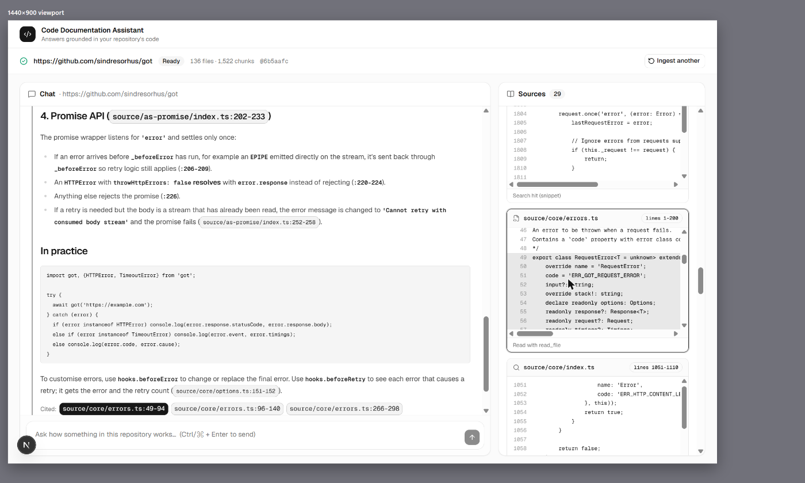
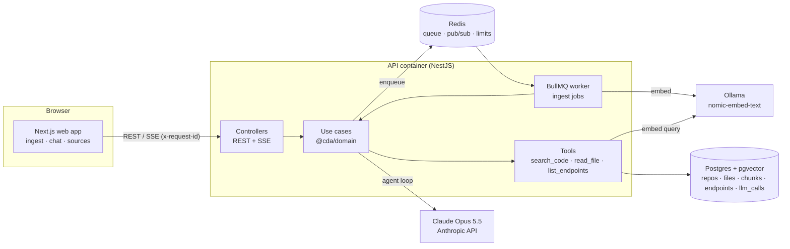
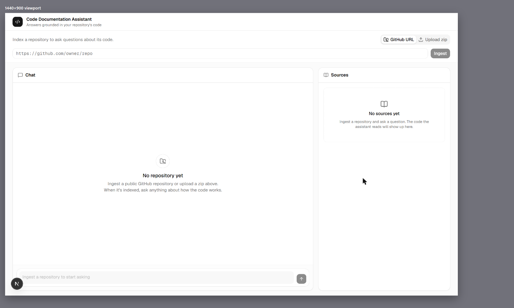
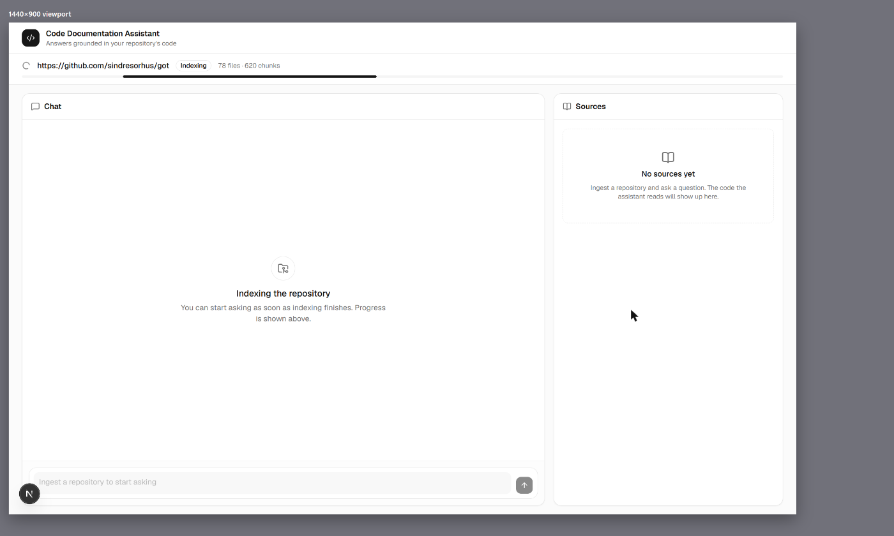
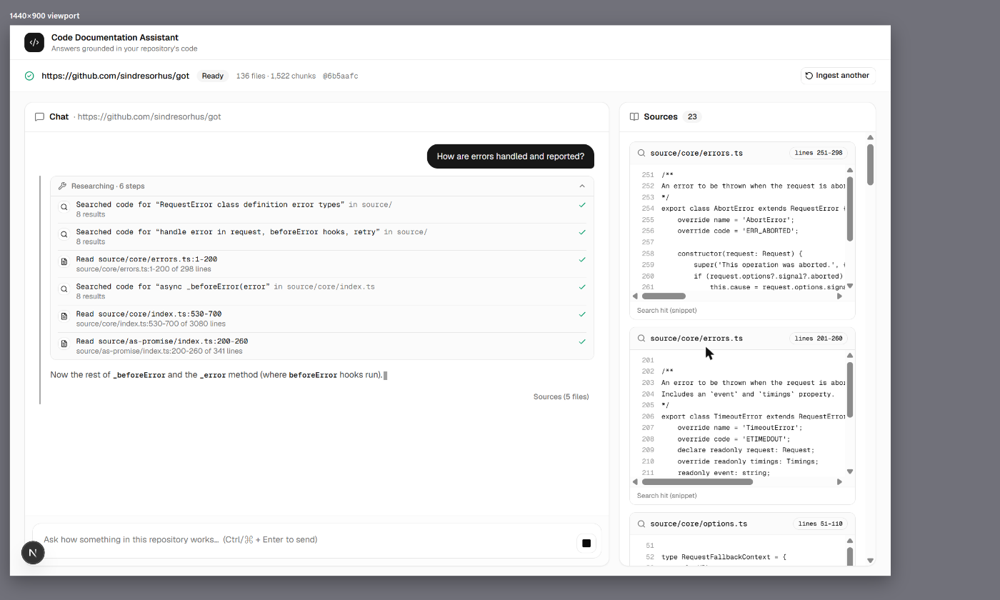
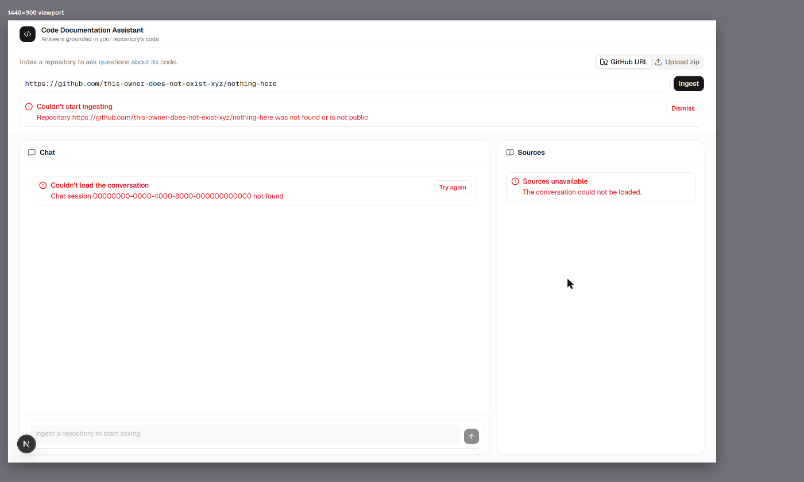
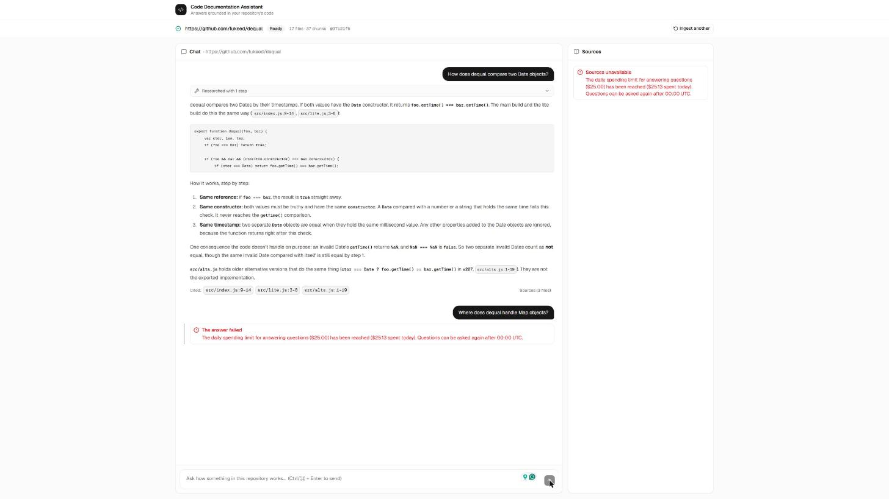
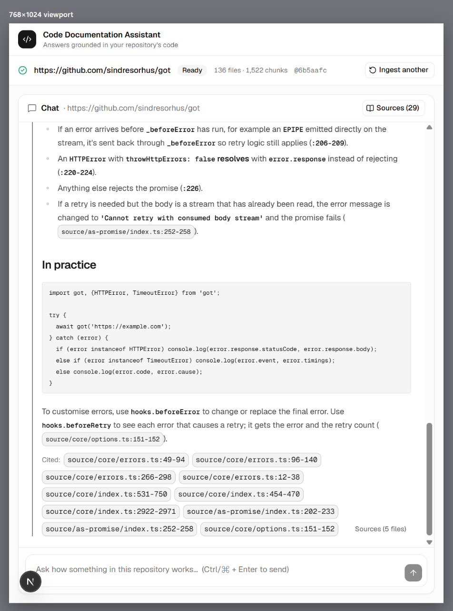
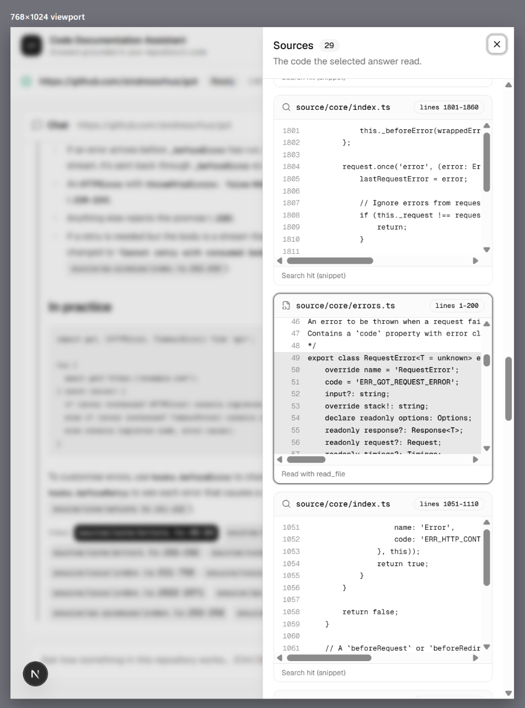

# Code Documentation Assistant

Ask questions about a code repository and get answers grounded in its source, with citations you can click.



You give it a public GitHub repo URL or a `.zip`, it indexes the code, and you ask questions in a chat. Every answer shows the searches and file reads the assistant made and the exact lines it used. If it can't back an answer with code it actually retrieved, it says "not found" rather than guessing.

It runs locally with Docker Compose. CI is green on GitHub Actions. Cloud deploy configs exist but nothing is deployed yet.

---

## Quick setup

**Needs:** Node.js 22 (22.12 or later), npm 10+, Docker (Desktop or Engine with Compose), an [Anthropic API key](https://platform.claude.com/). Optional: an NVIDIA GPU (faster embeddings), [uv](https://docs.astral.sh/uv/) and `make` (evals).

1. Clone and configure (`.env` must exist before `npm install`: its postinstall step runs `prisma generate`, which reads `DATABASE_URL`):
   ```
   git clone https://github.com/mdkmridul/code-doc-assistant.git
   cd code-doc-assistant
   cp .env.example .env
   ```
   In `.env`, set `ANTHROPIC_API_KEY`. If port 5432 is taken, change `POSTGRES_PORT` **and** the port in `DATABASE_URL` to match. Every variable is required; the API refuses to start and names what is missing. It also checks the Anthropic key at start: with an invalid key the `api` container keeps restarting (`docker compose logs api` shows the 401).
2. Install: `npm install`
3. Run everything in containers:
   ```
   docker compose --profile app up -d --build
   ```
   First run: builds two images and downloads the `nomic-embed-text` model (~270 MB). Migrations run automatically (`migrate` service). Open <http://localhost:3000>.
4. Try it: paste `https://github.com/lukeed/dequal` into the ingest box, wait for **Ready** (well under a minute on CPU), then ask *"How does dequal compare two Date objects?"*.
5. Stop: `docker compose --profile app down` (keeps data; add `-v` to delete it).

**Developing instead (hot reload):** `docker compose up -d` (Postgres, Redis, Ollama only), `npm run db:deploy -w api`, then `npm run start:dev -w api` and `npm run dev -w web` in two terminals.

**Checks:** `npm run lint`, `npm run typecheck`, `npm test` (unit), `npm run test:integration` (SQL and Redis against the Compose services). **Evals:** `make eval-retrieval` (free), `make eval-test` (free regression test), `make eval` (~$10, calls Claude). → `evals/README.md`

**GPU embeddings (NVIDIA):** uncomment the two `COMPOSE_*` lines in `.env`; `docker compose exec ollama ollama ps` should show `100% GPU`. → ADR 0009


---

## Architecture overview



Three parts:

- **Web app** (Next.js): one page with an ingest box, a chat, and a sources panel.
- **API** (NestJS): handles HTTP and streaming, runs the ingest worker (BullMQ), and runs the agent loop that answers questions. The core logic sits in a separate `packages/domain` package with no framework imports, so it can be unit-tested with fakes; the API wires it to Postgres, Redis, Ollama and Claude.
- **Stores and models**: Postgres with pgvector for files, chunks, vectors and logs; Redis for the job queue, progress events and usage limits; Ollama running `nomic-embed-text` for embeddings; Claude for answering.

**When you ingest a repo:** the API records it, queues a job, and the worker fetches one commit (or unzips the upload), splits each file into chunks, embeds the chunks, and stores file, chunks and vectors together. It also records any HTTP routes it finds. Progress streams to the browser. The same commit is never indexed twice.

**When you ask a question:** the API sends it to Claude with three tools. Claude searches the repo (`search_code`), reads files when a snippet isn't enough (`read_file`), and can list routes (`list_endpoints`). Tool results are capped so the context doesn't blow up. The loop stops when Claude answers or after 8 model calls. The answer must end with a citations block; each citation is checked against what was actually retrieved in that question, and if it doesn't hold up, the user gets "not found". Every model call is logged with tokens and cost.

MCP was in the plan as a third entrypoint over the same tools. It wasn't built in time.

---

## How it was built, in order

The sequence mattered more than any single component. Each step was built, verified against a short checklist, and committed before the next one started.

1. Monorepo, Docker Compose for Postgres and Redis, config validation.
2. Database schema and migrations.
3. Ingest: clone, chunk by line windows, embed, store.
4. Vector search as a tool.
5. The agent loop, non-streaming, tested with curl.
6. A plain web UI, so the whole flow worked end to end.
7. Streaming for answers and ingest progress.
8. The real UI: tool steps, sources panel, citation highlighting.
9. `read_file`, `list_endpoints`, the context budget.
10. Guardrails: citation validation, not-found, prompt injection, prompt versioning.
11. The eval harness, then hybrid search measured against it.
12. Logging, metrics, rate limit and spend cap.
13. Tests, CI, Docker packaging, deploy configs.

Symbol-level chunking with tree-sitter and the MCP entrypoint were the last items in the plan and were dropped when time ran out.

---

## Productionisation on a hyperscaler (Pitched by AI Agent)

**Smallest real deployment (configs ready, not deployed):** web on Vercel, API and worker as one Fly.io machine, Ollama as a second private Fly machine with the model baked in, Neon Postgres with pgvector, Upstash Redis. The Ollama image was trimmed from 8.5 GB to 755 MB so it fits a small machine. Since the URL would be public with no login, the daily spend cap is set to $2. Not deployed because I was waiting on the account logins.

**AWS design for real scale (not built):**

| Concern | Today | At scale on AWS |
|---|---|---|
| API | One container, API + worker | ECS Fargate service behind an ALB, autoscaled on CPU and open SSE connections; worker as its own ECS service scaled on queue depth |
| Postgres | One instance | RDS/Aurora PostgreSQL with pgvector; read replica for search; RDS Proxy for connection pooling |
| Redis | One instance | ElastiCache (cluster mode off for BullMQ); separate instances for queue and pub/sub/limits |
| Embeddings | Ollama on CPU/GPU | GPU instances (g5) behind an internal ALB, or a managed embedding endpoint with the same 768-d model |
| Uploads | Container temp dir | S3 (presigned upload), job references the object |
| Web | Next.js | Amplify/CloudFront, or Vercel |
| Secrets | `.env` / Fly secrets | Secrets Manager, rotated |
| Logs/metrics | JSON lines, `GET /metrics` | CloudWatch Logs + Insights on `requestId`; OpenTelemetry traces; alarms on spend, error rate, queue age |

**What's missing for real scale:** no authentication, everything single-tenant, rate limits per session rather than per user, the ingest worker sharing a process with the API, one embedding instance, no cleanup of old commits' chunks, no backups or alerting, and uploads on local disk.

---

## RAG and LLM approach

### LLM
Claude Opus 5.5, streaming, with prompt caching. I picked the strongest model I could call because the loop makes several calls per question and a weaker model wandered. Model prices are in code, and the API won't start with a model it can't price, so cost logging is always right.

### Embedding model
`nomic-embed-text` through Ollama, running locally. The first plan was Voyage's hosted code model. I switched because a local model needs no API key, has no rate limits, and keeps source code on the machine, which matters for zip uploads of private code. The trade-off is lower retrieval quality than a hosted code-trained model. On a GPU it's about 23× faster than CPU.

### Vector database
pgvector inside the same Postgres as the rest of the data. One database means a file, its chunks and its vectors commit together, filters are plain SQL joins, and there's one thing to run and back up. A separate vector store would only make sense at a scale this project isn't at.

Search is hybrid: vector similarity plus full-text keyword search, merged with reciprocal rank fusion. The reason is that code questions are half meaning ("how does caching work") and half exact identifiers ("where is `validateToken` defined"), and vector search is weak on the second kind. On the eval set, hybrid took identifier recall@5 from 33% to 50% and overall recall@10 from 45% to 52%.

### Orchestration
No framework. The agent loop is our own code over a `LanguageModel` interface. At this size a framework hides the parts I most wanted to see and test: the iteration cap, the token budget, the stop reasons, and cost per call. Limits: 8 model calls per question (the last one forced without tools, so a capped question still gets an answer) and a 200k token budget.

### Prompt and context management
System prompts are versioned files with a changelog; the API won't boot on a version that has no changelog entry, and each logged call records which version ran. Each tool result is truncated to roughly 8k tokens, and a result that would push the question past 40k is refused. Earlier turns are replayed as plain question and answer, without the tool traffic.

### Guardrails
Citations are validated against what was retrieved in this question: one rewrite if they fail, then a fixed "not found". Repository contents are treated as data; the prompt says instructions inside files are ignored, and a planted "ignore previous instructions" file had no effect in a live test. Off-topic questions get "not found" (4/4 in the eval set). Tool inputs are validated with zod. A per-session rate limit and a daily spend cap return readable errors.

### Quality
A golden set of 36 questions on the `ky` repo at a pinned commit: identifier, conceptual, multi-file and not-found questions. Retrieval recall needs no model; faithfulness and correctness are judged by a different model from the one answering. Current numbers with prompt v4 and hybrid search: 75% of answers faithful, correctness 4.79/5, 87.5% refusal on not-found, 0% false refusals, about $3.26 to run the set. A regression test fails CI if recall drops more than 5 points from the committed baseline.

### Observability
JSON logs with a request id that follows a request from HTTP into the ingest job and every model call. `GET /metrics` gives calls, tokens, cost and latency per day and per session. Every answer stores its tool trace.

---

## Key technical decisions


| Decision | Instead of | Why (one line) | ADR |
|---|---|---|---|
| pgvector in Postgres | Qdrant / Pinecone | one transaction, one system, SQL filters | 0010 |
| Prisma + hand-written search migration | raw SQL everywhere | typed models and drift checks; Unsupported columns by hand | 0005 |
| Own agent loop | LangGraph, agent SDK | testable limits, cost per call, provider rules in one adapter | 0011 |
| Local nomic embeddings via Ollama | hosted `voyage-code-3` | no key or rate limits; code stays local; GPU optional | 0009 |
| Hybrid retrieval with RRF | vector only, weighted blending | identifiers found exactly; ranks need no score calibration | 0018 |
| Parsed citation block, validated | trusting inline references | invented citations rejected; not-found instead of guessing | 0017 |
| SSE for answers and progress | WebSockets, polling | one-way streams over plain HTTP; disconnect cancels the loop | 0013 |
| Dedupe ingests by source version | by URL | same commit never embedded twice; new commit re-ingests | 0007 |
| Usage limits in Redis | in-process counters | shared across API processes | 0020 |
| Containers to run, host to develop | containers only | hot reload and native tooling on Windows | 0015 |
| Evals as a uv Python project | npm workspace | eval is an API client; Python eval toolkit | 0019 |
| CI: evals on a PR label | every push | evals cost money | 0021 |

All ADRs are in `docs/decisions/`.

---

## Engineering standards

**Followed:** strict TypeScript, ESLint and Prettier, domain package kept framework-free by a lint rule, unit tests with fakes for every use case (218 tests, coverage thresholds in CI), SQL tested against real Postgres and Redis (21 integration tests), an ADR for every choice, migrations never edited after commit, config validated at boot, CI on every push.

**Skipped, on purpose:** authentication, multi-tenancy, end-to-end browser tests (component tests and manual checks only), load testing, a security review beyond input validation and prompt injection, deployment, backups and alerting.

---

## How AI tools were used

This project was built with Claude Code, and I want to be accurate about the split.

I set the architecture (Next, Nest, a framework-free domain package, Postgres with pgvector, Redis, our own agent loop), the order of the steps above, and the verification checklist for each step. Claude Code implemented each step, and made most of the detailed choices inside it: index parameters, the exact budget numbers, the shape of the citation block, the eval metrics. I reviewed the output of every step against its checklist (lint, typecheck, tests, and a live run in the browser or with curl), read the ADRs it wrote, and pushed back when something didn't match the plan or didn't work. I understand the system at the level described in this README; some of the lower-level implementation detail is the agent's, recorded in the ADRs, and I'd read the relevant file before changing it.

The standing rules live in `CLAUDE.md`, checked in, and were updated together with the code they describe. One ad-hoc sub-agent drafted the eval golden set from the repo source with a line-range comment for every fact, which I checked afterwards.

**What worked:** rules in `CLAUDE.md` instead of repeated in chat; one step at a time with a verify line; "done" meaning lint, typecheck, tests and a live check; an ADR for every decision so the "why" is recorded.

**What went wrong and what I'd keep in mind:** unit tests with a fake model missed two real API bugs (message ordering and a missing format example) that only a live eval run caught; CI on Linux caught a filename bug that passed on Windows; a truncated excerpt made the eval judge mark correct answers as unsupported until it was shown exactly what the model saw; and letting the agent write regexes through shell heredocs mangled escapes several times, while direct file edits were reliable.

---

## Limitations, and what I'd do with more time

- MCP entrypoint not built.
- Faithfulness is 75%: the model sometimes quotes code beyond the snippet it saw. Next: validate citations against snippet lines, and push it to `read_file` before quoting.
- Recall on `ky` is around 52% at 10 because test files crowd out source. Next: down-weight `test/`, and chunk by function and class with tree-sitter instead of line windows.
- Hybrid search improves retrieval but not yet answer quality; the agent compensates by searching more.
- One ambiguous not-found question in the golden set; a few shorthand citation formats not parsed; the spend counter isn't seeded from the database after a Redis flush.

---

## Beyond the brief


| Item | Why it was added |
|---|---|
| Per-session rate limit and daily spend cap | Marked "Beyond" in the observability step: a public deploy must not run up an unbounded bill. → ADR 0020 |
| GPU Compose override | CPU embedding of a large repo took minutes; GPU about 23× faster. → ADR 0009 |
| `list_endpoints` paging (`offset`) | The first live run paged through 134 routes with odd filters (10 calls); paging cut it to 4. → ADR 0016 |
| Endpoint backfill script | Repos ingested before the endpoint scan existed would otherwise show no routes. → `apps/api/prisma/backfill-endpoints.ts` |
| Prompt changelog enforced at boot | An unrecorded prompt version can never run. → `apps/api/src/chat/prompt-loader.ts` |
| `POST /repos/:id/search` | Recall@k without a model call, for evals and the regression test. → `apps/api/src/search/` |
| Slim Ollama image | 8.5 GB → 755 MB, small enough for a small cloud machine. → `deploy/ollama/Dockerfile` |

---

## Screenshots and recording

| | |
|---|---|
|  Empty |  Ingest progress |
|  Answer streaming |  Citation highlighted |
|  Error states |  Spend cap reached |
|  Tablet |  Tablet, sources sheet |

